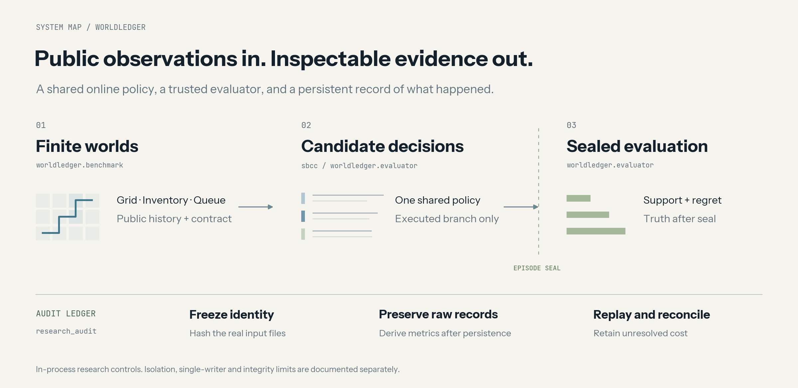

<div align="center">


**Evaluate candidate worlds. Keep decisions and evidence together.**

[](https://github.com/LeriusLei/worldledger-toolkit/actions/workflows/ci.yml)
[](pyproject.toml)
[](LICENSE)
[](examples/)

[Documentation](docs/README.md) · [Get started](#get-started) · [Examples](docs/EXAMPLES.md) · [Modules](#building-blocks) · [简体中文](README.zh-CN.md)

</div>

WorldLedger is a Python toolkit for studying **how executable world models affect decisions**. It combines finite environments, exact regret evaluation, coherent candidate committees and an experiment audit ledger in three reusable packages.

- **Inspect the candidate set.** Measure behavioral coverage, decision coverage and the risk introduced by omitted worlds.
- **Separate online action from evaluation.** Record the executed branch and unlock evaluator-only truth after the episode is sealed.
- **Keep the evidence attached.** Hash inputs, persist raw records before metrics, replay events and retain unresolved cost.

The included tasks are transparent synthetic controls. The library is experimental; [evidence and applicability](docs/EVIDENCE.md) are documented alongside the implementation.

## Get started

Python 3.10–3.12 · CPU · no model downloads or API keys for the examples.

```bash
git clone https://github.com/LeriusLei/worldledger-toolkit.git
cd worldledger-toolkit
python -m venv .venv
# Linux/macOS: source .venv/bin/activate
# Windows PowerShell: .venv\Scripts\Activate.ps1
python -m pip install -e ".[dev,plots]"
python examples/finite_worlds.py
```

[Installation details, audit-ledger usage and installed-wheel notes →](docs/QUICKSTART.md)

## Same coverage. Different omission risk.

Two candidate pools can cover the same fraction of a model family while supporting different decisions. Here is a complete, offline example using two hand-selected pools from one registered Grid instance:

```python
from worldledger.benchmark.generators.grid import generate_family_instance
from worldledger.benchmark.history_generator import generate_histories
from worldledger.evaluator.regret import evaluate_pool

world = generate_family_instance(4)
history = generate_histories(world, world.models[0])[0]
pools = {"A": world.models[:2], "B": world.models[::2]}

for name, models in pools.items():
    report = evaluate_pool(world, history, [m.model_id for m in models], horizon=1)
    print(name, "coverage:", report["hcr"], "omission regret:", report["delta_omit"])
```

```text
A coverage: 0.5 omission regret: 0.0
B coverage: 0.5 omission regret: 3.0
```

Both pools are history-consistent. `delta_omit` measures the added worst-case regret of the retained pool's policy against the full consistent support. This is an exact one-step finite-family control; [interpretation and further cases](docs/EXAMPLES.md#coverage-and-decision-risk) stay tied to that setting.

## Building blocks

| Package | Reuse it for | Explore |
|---|---|---|
| **`worldledger`** | Finite tasks, exact support and regret, shared observation-contingent policies, bounded source interpretation | [Task families](worldledger/benchmark/) · [Evaluators](worldledger/evaluator/) · [Finite kernels](worldledger/world_model/) |
| **`sbcc`** | Coherent committees, action sets, episode-level statistics, counterfactual trace controls and model-local rollouts | [Decision components](sbcc/) · [Information boundary](sbcc/information_firewall.py) |
| **`research_audit`** | Input identity, raw-first records, hash-linked events, conservative cost accounting and replay | [Ledger API](research_audit/harness.py) · [Offline example](examples/audit_ledger.py) |

### How the pieces connect



The online policy sees public observations. A trusted evaluator records counterfactual metrics; sealed results stay outside the online trace. The ledger records execution facts across the workflow. [Interfaces and operational limits →](docs/ARCHITECTURE.md)

## Explore the controls

| Question | Run from the repository root | What to inspect |
|---|---|---|
| How does factual history narrow model support? | `python examples/finite_worlds.py` | Grid, Inventory and Queue support: 4 → 2 → 1 |
| Which information changes a decision? | `python experiments/run_sprinkler.py --seeds 400 --output-dir artifacts/sprinkler` | Utility, model entropy and decision classes |
| What happens when candidate components are crossed? | `python experiments/run_hybrid_counterexample.py --output-dir artifacts/hybrid` | All four transition/reward pairs |
| Can a record retain uncertainty and detect mutation? | `python examples/audit_ledger.py` | Actual file rehash, raw-first persistence and unknown cost |


The figure uses the [published 400-seed summary](docs/demo_results/sprinkler_summary.json), with balanced assignments, noiseless probes and cost 0.05. It illustrates a constructed mechanism. [See the full example gallery, component-mixing figure and scope of each control →](docs/EXAMPLES.md)

## Reproducibility

```bash
python -m pytest -q
python scripts/privacy_check.py
python scripts/check_docs.py
python scripts/create_figures.py
```

The [CI matrix](https://github.com/LeriusLei/worldledger-toolkit/actions/workflows/ci.yml) covers Linux and Windows on Python 3.10, 3.11 and 3.12, including examples, privacy checks and distribution builds. [Source hashes](docs/SOURCE_MANIFEST.json), [demo data](docs/demo_results/), [validation records](docs/VALIDATION.md) and [figure sources](scripts/create_visuals.py) make the release inspectable.

## Go deeper

| Start here | Continue with |
|---|---|
| [Documentation index](docs/README.md) | Installation, examples and module entry points |
| [Architecture](docs/ARCHITECTURE.md) | Policy scope, evaluator isolation, AST language and ledger contract |
| [Evidence boundaries](docs/EVIDENCE.md) | What the synthetic controls establish and what remains unproven |
| [Project map](docs/PROJECT_MAP.md) | Release choices, historical branches and source provenance |

Contributions are welcome through [issues](https://github.com/LeriusLei/worldledger-toolkit/issues) and pull requests. Read the [contribution guide](CONTRIBUTING.md), [community conduct](CODE_OF_CONDUCT.md) and [security policy](SECURITY.md). Cite the software with [CITATION.cff](CITATION.cff).

**License:** [MIT](LICENSE), with [upstream notices](THIRD_PARTY_NOTICES.md) for adapted code and bundled fonts. This independent public tree excludes credentials, private conversations, raw provider responses, model caches and the original private Git history.
