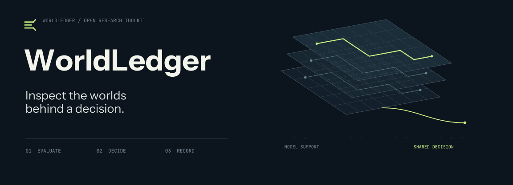
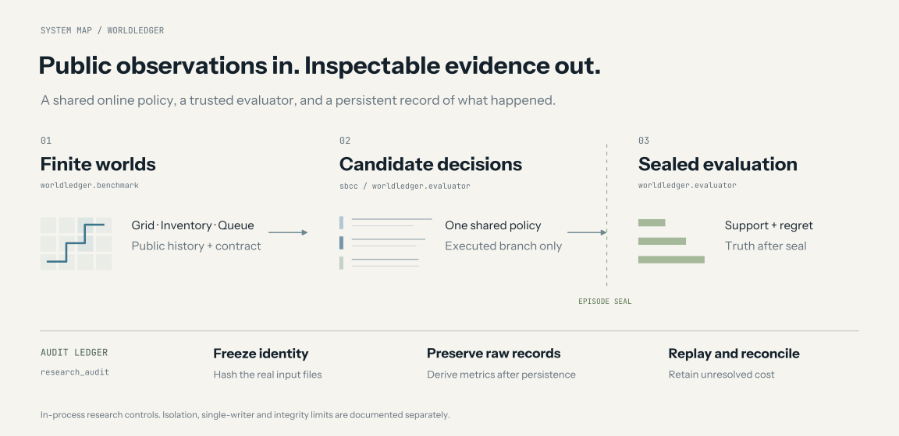
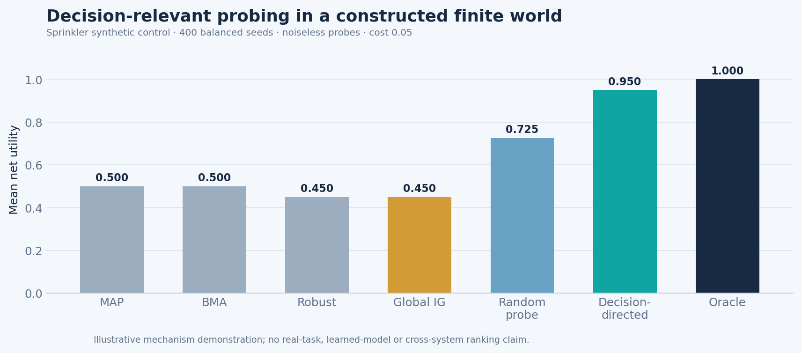

<div align="center">



**Offline evaluation and auditable experiments for executable world models.**

[](https://github.com/LeriusLei/worldledger-toolkit/actions/workflows/ci.yml)
[](pyproject.toml)
[](LICENSE)
[](examples/)

[English](README.md) · [简体中文](README.zh-CN.md) · [Quick start](#quick-start) · [Modules](#reusable-modules) · [Evidence boundaries](docs/EVIDENCE.md)

</div>

WorldLedger Toolkit brings together the reusable engineering from a world-model research project: finite environments, exact regret evaluation, candidate committees, controlled counterfactual evaluation, and an append-only experiment ledger. Use it to ask **whether models disagree in ways that change a decision**, while keeping evaluator-only truth out of the online agent trace.

This is an **experimental toolkit with synthetic evaluation suites**. The release contains Python components and finite model specifications. Trained neural-network weights, a public model leaderboard, and a demonstrated general-purpose world-model method are outside its scope. The original project's negative and inconclusive research findings remain negative and inconclusive; see [what the evidence supports](docs/EVIDENCE.md).

## Quick start

Python 3.10–3.12 is the CI target. A CPU is sufficient; the shipped examples need no API keys, model downloads, GPU, or provider account. Installing dependencies requires access to a Python package index unless they are already available locally.

```bash
git clone https://github.com/LeriusLei/worldledger-toolkit.git
cd worldledger-toolkit
python -m venv .venv
# Linux/macOS: source .venv/bin/activate
# Windows PowerShell: .venv\Scripts\Activate.ps1
python -m pip install -e ".[dev,plots]"
python -m pytest -q
```

Run these commands from the repository root:

```bash
python examples/finite_worlds.py
python examples/audit_ledger.py
python experiments/run_sprinkler.py --seeds 400 --output-dir artifacts/sprinkler
python experiments/run_hybrid_counterexample.py --output-dir artifacts/hybrid_counterexample
python scripts/privacy_check.py
```

The two examples print JSON. The experiments produce machine-readable summaries, CSV records and explanatory Markdown under the selected output directory. The Sprinkler runner also produces PNG plots when Matplotlib is installed. [See expected outputs and API examples →](docs/QUICKSTART.md)

## Reusable modules

| Module | What you can reuse | Starting point |
|---|---|---|
| Finite task families | Procedural Grid, Inventory and Queue worlds; factual histories and exact consistency sets | [`worldledger/benchmark`](worldledger/benchmark/) |
| Exact evaluation | Behavior/decision equivalence, candidate omission, shared observation-contingent minimax policies | [`worldledger/evaluator`](worldledger/evaluator/), [`worldledger/world_model`](worldledger/world_model/) |
| Decision components | Coherent candidate committees, action sets, hybrid-support diagnostics, ranking and episode-level statistics | [`sbcc`](sbcc/) |
| Evaluator isolation | Deep-copied payloads, restored Python/NumPy RNG, post-episode truth sealing and paired-trace checks | [`information_firewall.py`](sbcc/information_firewall.py) |
| Bounded source language | AST validation and interpretation of a small transition/observation/reward language | [`worldledger/sandbox`](worldledger/sandbox/), [`v04/runtime.py`](worldledger/v04/runtime.py) |
| Experiment audit ledger | Immutable manifest identity, raw-before-derived records, hash-linked events and conservative unknown-cost accounting | [`research_audit`](research_audit/) |
| Imagination utilities | NumPy lambda returns, coherent model rollouts and categorical CEM | [`imagined_rollouts.py`](sbcc/imagined_rollouts.py) |

The source interpreters and evaluator channel are research controls, not an OS security boundary. The audit ledger is single-writer, and its local hash chain is an integrity check rather than signed attestation. [Architecture and limitations →](docs/ARCHITECTURE.md)



## Included experiments

**Sprinkler decision ambiguity.** In a deliberately constructed finite setting, some probes identify nuisance detail while another identifies the action-relevant variable. The experiment compares MAP, BMA, robust choice, global information gain, random probing, decision-directed probing and an evaluator oracle. The figure below is generated from the shipped 400-seed run, not a real-world model benchmark.



The [published summary](docs/demo_results/sprinkler_summary.json) records the exact configuration. Seeds follow a balanced factorial assignment, and observations are noiseless in this illustration. Treat this as a mechanism demonstration; the bars do not estimate performance across real tasks or independent learned models.

**Component mixing counterexample.** Two coherent candidate worlds agree that the safe action is best. Crossing their transition and reward components creates combinations outside the original candidate set and an unsupported action ranking. Run the exact counterexample and inspect all four pairs. It establishes that this failure can occur under the constructed interface; it does not estimate its prevalence in other systems.

**Finite-world accounting and audit ledger.** The examples show support shrinking after public observations, retain failed/empty candidate pools in evaluation, and replay a ledger in which unknown cost stays reserved. These are engineering demonstrations, not evidence of scientific success.

## Why this release is a toolkit

The project's useful outcome is a collection of independently reusable controls and evaluators. Its research branches used different contracts, and several failed their scientific or generation-reliability gates. A general benchmark or a small-model release would imply evidence or weights this repository does not provide. We therefore expose the working components, synthetic controls, limitations and provenance together. [Release choices and project map →](docs/PROJECT_MAP.md)

## Repository guide

```text
worldledger/      finite worlds, exact evaluators, bounded source interpreters
sbcc/             decision committees, trace controls, statistics, rollouts
research_audit/   raw-first experiment ledger and identity checks
examples/         small offline examples
experiments/      reproducible synthetic experiments
tests/            unit and integration checks for released components
docs/             architecture, evidence boundaries, figures, source manifest
scripts/          privacy and documentation checks
.github/          CI and issue/pull-request templates
```

## Contributing and citation

Start with [CONTRIBUTING.md](CONTRIBUTING.md), [SECURITY.md](SECURITY.md), [CODE_OF_CONDUCT.md](CODE_OF_CONDUCT.md) and [the module guide](docs/ARCHITECTURE.md). Cite this software using [CITATION.cff](CITATION.cff). Please preserve failed-run denominators, evaluator information boundaries and the distinction between synthetic controls and empirical results.

Released under the [MIT License](LICENSE). The NumPy return implementation adapted from DreamerV3 retains its [upstream notice](licenses/DreamerV3-MIT.txt); other related projects are linked in [THIRD_PARTY_NOTICES.md](THIRD_PARTY_NOTICES.md). Private credentials, conversations, provider responses, model caches, manuscript drafts and the original Git history are excluded from this independent release.
