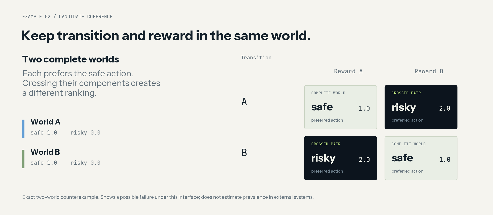

# Example gallery

Each control answers a specific implementation or finite-model question. Commands run offline from the repository root after installation.

## Coverage and decision risk

The [README code](../README.md#same-coverage-different-omission-risk) selects two two-model pools from Grid seed 4 at history H0 and horizon 1. Both cover half of the four-model consistent family. Pool A adds 0.0 omission regret and pool B adds 3.0. This is a hand-selected illustrative comparison, not an estimate of how frequently coverage and regret differ.

`delta_omit` compares the minimax policy selected from the retained, history-consistent pool against the policy selected from the full consistent support, evaluating both on that same full support. Deployment regret is a separate field and can use a different deployment rule. Undefined empty-pool values remain null.

## Decision-relevant information

```bash
python experiments/run_sprinkler.py --seeds 400 --output-dir artifacts/sprinkler
```


The figure reads [sprinkler_summary.json](demo_results/sprinkler_summary.json). The displayed 400-seed control uses balanced assignments, 32 candidate hypotheses, noiseless probes and probe costs of 0.05. Decision-directed probing retains four bits of model entropy with one decision class, while GlobalIG retains one bit with two decision classes. Mean net utilities and remaining uncertainty are different properties; the example makes both visible. Means are shown without confidence bars and do not estimate cross-task or learned-model performance.

Outputs include `trials.csv`, `summary.json`, `RESULTS.md` and optional plots.

## Candidate coherence

```bash
python experiments/run_hybrid_counterexample.py --output-dir artifacts/hybrid
```



Both complete worlds assign safe=1 and risky=0. The crossed transition/reward pairs assign risky=2 and prefer the risky action. The four-pair enumeration is generated by [hybrid_ensemble.py](../sbcc/hybrid_ensemble.py); its summary is [published here](demo_results/hybrid_summary.json). The dark cells are constructed crossed pairs, not additional naturally induced models. This establishes a possible non-closure failure under this interface, not its prevalence in external systems.

## Public-history support

```bash
python examples/finite_worlds.py
```

Grid, Inventory and Queue return support sizes `[4, 2, 1]` over their three public histories. The independent Machine Maintenance contract has four assignments and an exact horizon-five shared policy. These counts belong to the registered finite contracts.

## Raw records and unresolved cost

```bash
python examples/audit_ledger.py
```

The example hashes actual synthetic input files, records a raw observation before a derived metric, detects a changed protocol file and replays a known cost of 0.40 with 2.00 still reserved. Costs are illustrative units. This demonstrates bookkeeping and mutation detection; scientific interpretation remains outside the ledger.

Read [architecture and limitations](ARCHITECTURE.md) before adapting the examples to a new domain.
